## Table of Contents

- [1. Purpose](#1-purpose)
- [2. Inputs](#2-inputs)
  - [2.1 Hardcoded test-case inputs](#21-hardcoded-test-case-inputs)
  - [2.2 Configuration values initialised inside the program](#22-configuration-values-initialised-inside-the-program)
- [3. Outputs](#3-outputs)
- [4. Processing Logic](#4-processing-logic)
  - [4.1 Mermaid Flow Diagram](#41-mermaid-flow-diagram)
  - [4.2 Processing Logic Description](#42-processing-logic-description)
  - [4.3 Database Tables (if applicable)](#43-database-tables-if-applicable)
- [5. Paragraphs](#5-paragraphs)
- [6. Dependencies](#6-dependencies)
  - [6.1 External Systems and Data Sources](#61-external-systems-and-data-sources)
  - [6.2 Input Parameters and Data Sources](#62-input-parameters-and-data-sources)
  - [6.3 External Programs, Modules and Copybooks](#63-external-programs-modules-and-copybooks)
  - [6.4 Intrinsic Runtime Functions](#64-intrinsic-runtime-functions)
  - [6.5 Configuration Values and Internal Constants](#65-configuration-values-and-internal-constants)
  - [6.6 Operation Code and Status Code Conventions](#66-operation-code-and-status-code-conventions)
  - [6.7 Output Destinations](#67-output-destinations)
  - [6.8 Runtime and Platform Dependencies](#68-runtime-and-platform-dependencies)
- [7. Constraints](#7-constraints)
- [8. Error Handling](#8-error-handling)
  - [8.1 Status-code-based error signaling](#81-status-code-based-error-signaling)
  - [8.2 Operation code validation](#82-operation-code-validation)
  - [8.3 Input range (boundary) validation](#83-input-range-boundary-validation)
  - [8.4 Arithmetic exception handling](#84-arithmetic-exception-handling)
  - [8.5 Fallback and trivial-case handling](#85-fallback-and-trivial-case-handling)
  - [8.6 Self-verification and reporting of outcomes](#86-self-verification-and-reporting-of-outcomes)
  - [8.7 Absent mechanisms and limitations](#87-absent-mechanisms-and-limitations)
- [9. Examples](#9-examples)
  - [9.1 Example 1: Addition within limits (test 1)](#91-example-1-addition-within-limits-test-1)
  - [9.2 Example 2: Out-of-range operand (test 4)](#92-example-2-out-of-range-operand-test-4)
  - [9.3 Example 3: Negative subtraction result rejected (test 7)](#93-example-3-negative-subtraction-result-rejected-test-7)
  - [9.4 Example 4: Multiplication overflow and precision loss (tests 11 and 13)](#94-example-4-multiplication-overflow-and-precision-loss-tests-11-and-13)
  - [9.5 Example 5: Division checks and the invalid operation code (tests 14, 15, 17, 19)](#95-example-5-division-checks-and-the-invalid-operation-code-tests-14-15-17-19)
  - [9.6 Example 6: Final summary](#96-example-6-final-summary)

## 1. Purpose

CALCOPS1 is a sample calculator program that does addition, subtraction, multiplication and division. Each operation is handled on its own and checked with conditional logic and boundary rules. Before it does any arithmetic, it checks that both operands fall within a permitted range. It also catches special conditions for each operation:
- Divide-by-zero.
- A divisor too small to give a reliable result.
- Multiplication results that round to zero.
- Negative subtraction results when they aren't allowed.
- Overflow.
- Invalid operation codes.

The program also works as a self-contained test harness. It loads a fixed set of test cases for normal, boundary and error scenarios. It runs each case through the calculator and compares the resulting status code with the expected one. It displays a pass or fail line for each case, followed by a summary of tests run, passed and failed. It uses no file or message input or output.

## 2. Inputs

- The program takes no external inputs. It has no LINKAGE SECTION and its PROCEDURE DIVISION has no USING clause. It has no ACCEPT statements, file I/O, SQL, MQ calls, or environment variable access. The source header says "TEST CASES LOADED IN 0000-MAIN-PARA (NO FILE I/O)".

### 2.1 Hardcoded test-case inputs
`0000-MAIN-PARA` sets these values with MOVE statements before each call to `2000-RUN-TEST-CASE`. They are literals in the source, not data from outside the program.

- Operation selector
  - `WS-OP-CODE` picks the operation. 'A' is add, 'S' is subtract, 'M' is multiply, 'D' is divide, and any other value is an invalid operation. The test cases use 'A', 'S', 'M', 'D' and 'X'.
- Operands
  - `WS-OPERAND-A` is the first operand: the augend, minuend, multiplicand or dividend.
  - `WS-OPERAND-B` is the second operand: the addend, subtrahend, multiplier or divisor.
  - The test cases use these values:
    - Typical values, such as 100.00 and 250.50.
    - Zero values.
    - Negative values, such as -500.00.
    - Boundary values, such as +4999999.99 and +5000000.01.
    - Small values that trigger precision loss, such as +0.01 and +0.05.
- Expected outcome
  - `WS-EXPECTED-STATUS` holds the status code each test case should produce. The program compares it with the actual status to report PASS or FAIL. The values used are '00', '10', '20', '30', '40', '50' and '60'.

### 2.2 Configuration values initialised inside the program
These are fixed in the program and not supplied from outside.

- Operand limits
  - `WS-MAX-OPERAND` is +5000000.00, the highest operand value allowed.
  - `WS-MIN-OPERAND` is -5000000.00, the lowest operand value allowed.
- Division rule
  - `WS-PRECISION-FLOOR` is +0.1000, the smallest absolute divisor allowed.
- Subtraction rule
  - `WS-ALLOW-NEGATIVE` is set to 'N' in `1000-INITIALIZE-PARA`. This means negative subtraction results are not permitted. Nothing in the program ever changes it.

## 3. Outputs

- **Console output (DISPLAY)**
  - Per-test result line, written once for each of the 22 test cases in `4000-REPORT-RESULT`.
    - Passing test: `TEST <no> OP=<code> STATUS=<status> RESULT=<edited result> PASS`.
    - Failing test: `TEST <no> OP=<code> STATUS=<status> EXPECTED=<expected status> FAIL`. This line has no result value.
    - A test passes when the final status code equals the expected status code.
  - Summary lines, written by `9000-DISPLAY-SUMMARY` after all tests have run.
    - `CALCOPS1 TESTS RUN : <count>`
    - `CALCOPS1 PASSED    : <count>`
    - `CALCOPS1 FAILED    : <count>`

- **Values shown in the output lines**
  - `WS-TEST-NO`
    - Sequence number of the test case.
    - Incremented for each test and also used as the total tests-run count in the summary.
  - `WS-OP-CODE`
    - Operation code of the test: A (add), S (subtract), M (multiply), D (divide). Any other value, such as X, is invalid.
  - `WS-STATUS-CODE`
    - Outcome status of the calculation, shown as a 2-character code.
    - `00`: success.
    - `10`: `STATUS-OVERFLOW`, a size error in the arithmetic.
    - `20`: `STATUS-DIVIDE-BY-ZERO`, a zero divisor.
    - `30`: `STATUS-INVALID-OPERATION`, an unknown operation code.
    - `40`: `STATUS-OUT-OF-RANGE`, an operand outside the minimum and maximum limits.
    - `50`: `STATUS-NEGATIVE-RESULT`, a negative subtraction result when negatives are not allowed.
    - `60`: `STATUS-PRECISION-LOSS`, a multiplication that rounds to zero, or a divisor below the precision floor.
  - `WS-EXPECTED-STATUS`
    - Status the test expected.
    - Displayed only on FAIL lines, to show the mismatch.
  - `WS-DISPLAY-RESULT`
    - Numeric-edited form of `WS-RESULT`, with a floating minus sign and 2 decimals.
    - Displayed only on PASS lines.

- **Calculation outputs (working storage)**
  - `WS-RESULT`
    - Result of the add, subtract, multiply or divide.
    - Reset to zero before each test, and set to zero explicitly for trivial cases (zero operands, equal subtraction operands, zero dividend).
    - Multiplication and division results are rounded.
    - It stays zero when a check rejects the operands, and on a size error its content is not reliable.
  - `WS-REMAINDER`
    - Remainder from the divide operation.
    - Reset to zero for every test and set only when a division runs.
    - It is never displayed, so it has no visible effect on the output.

- **Summary counters**
  - `WS-PASS-COUNT`
    - Number of tests whose actual status matched the expected status.
  - `WS-FAIL-COUNT`
    - Number of tests whose actual status did not match.
  - `WS-TEST-NO`
    - Total number of tests run.

- **Other observable effects**
  - The program does no file, database, API or message-queue I/O and returns no values.
  - It ends with `STOP RUN` and sets no explicit return code.
  - The only observable results are the DISPLAY lines.

## 4. Processing Logic

### 4.1 Mermaid Flow Diagram

```mermaid
graph TD
    classDef startEnd fill:#D4E6F1,stroke:#5499C7,color:#000;
    classDef proc fill:#FCF3CF,stroke:#F1C40F,color:#000;
    classDef cond fill:#FADBD8,stroke:#E74C3C,color:#000;
    classDef status fill:#D5F5E3,stroke:#58D68D,color:#000;

    Start([Start CALCOPS1]):::startEnd
    Init[Initialize Test Counters and Settings]:::proc
    LoadTest[Load Next Test Case Operands and Op Code]:::proc
    RunTest[Increment Test Number and Reset Result Buffers]:::proc
    CheckOp{{Evaluate Operation Code}}:::cond

    AddPara[3000-ADDITION-PARA]:::proc
    SubPara[3100-SUBTRACTION-PARA]:::proc
    MulPara[3200-MULTIPLY-PARA]:::proc
    DivPara[3300-DIVIDE-PARA]:::proc
    InvOp[Set Status Invalid Operation 30]:::status

    CheckAddLimits{{Operands Out of Range?}}:::cond
    AddZero{{Both Operands Zero?}}:::cond
    SetAddZero[Set Result to Zero and Status OK]:::status
    SetAddRange[Set Status Out Of Range 40]:::status
    PerformAdd[Add Operand A and Operand B]:::proc
    AddSize{{Size Error on Add?}}:::cond
    SetAddOvfl[Set Status Overflow 10]:::status
    SetAddOk[Set Status OK 00]:::status

    CheckSubLimits{{Operands Out of Range?}}:::cond
    SubEqual{{Operands Equal?}}:::cond
    SetSubZero[Set Result to Zero and Status OK]:::status
    SetSubRange[Set Status Out Of Range 40]:::status
    PerformSub[Subtract Operand B from Operand A]:::proc
    SubSize{{Size Error on Sub?}}:::cond
    SetSubOvfl[Set Status Overflow 10]:::status
    SubNegCheck{{Result Negative and Not Allowed?}}:::cond
    SetSubNeg[Set Status Negative Result 50]:::status

    CheckMulLimits{{Operands Out of Range?}}:::cond
    MulZero{{Either Operand Zero?}}:::cond
    SetMulZero[Set Result to Zero and Status OK]:::status
    SetMulRange[Set Status Out Of Range 40]:::status
    PerformMul[Multiply Operand A by Operand B Rounded]:::proc
    MulSize{{Size Error on Multiply?}}:::cond
    SetMulOvfl[Set Status Overflow 10]:::status
    MulPrecCheck{{Status OK and Result Zero?}}:::cond
    SetMulPrec[Set Status Precision Loss 60]:::status

    CheckDivLimits{{Operands Out of Range?}}:::cond
    SetDivRange[Set Status Out Of Range 40]:::status
    DivZero{{Operand B Equal Zero?}}:::cond
    SetDivByZero[Set Status Divide By Zero 20]:::status
    DivFloor{{Absolute Operand B Below Precision Floor?}}:::cond
    SetDivPrec[Set Status Precision Loss 60]:::status
    DivNumZero{{Operand A Equal Zero?}}:::cond
    SetDivZero[Set Result to Zero and Status OK]:::status
    PerformDiv[Divide Operand A by Operand B Rounded with Remainder]:::proc
    DivSize{{Size Error on Divide?}}:::cond
    SetDivOvfl[Set Status Overflow 10]:::status

    Report[4000-REPORT-RESULT<br>Compare Status Code with Expected Status]:::proc
    StatusMatch{{Status Code Equals Expected Status?}}:::cond
    PassCount[Increment Pass Counter and Display PASS]:::proc
    FailCount[Increment Fail Counter and Display FAIL]:::proc
    MoreTests{{More Test Cases to Run?}}:::cond
    Summary[9000-DISPLAY-SUMMARY<br>Display Total Passed and Failed Tests]:::proc
    End([Stop Run]):::startEnd

    Start --> Init
    Init --> LoadTest
    LoadTest --> RunTest
    RunTest --> CheckOp

    CheckOp -- OP-ADD --> AddPara
    CheckOp -- OP-SUBTRACT --> SubPara
    CheckOp -- OP-MULTIPLY --> MulPara
    CheckOp -- OP-DIVIDE --> DivPara
    CheckOp -- OTHER --> InvOp

    InvOp --> Report

    AddPara --> CheckAddLimits
    CheckAddLimits -- Yes --> SetAddRange
    CheckAddLimits -- No --> AddZero
    AddZero -- Yes --> SetAddZero
    AddZero -- No --> PerformAdd
    PerformAdd --> AddSize
    AddSize -- Yes --> SetAddOvfl
    AddSize -- No --> SetAddOk
    SetAddRange --> Report
    SetAddZero --> Report
    SetAddOvfl --> Report
    SetAddOk --> Report

    SubPara --> CheckSubLimits
    CheckSubLimits -- Yes --> SetSubRange
    CheckSubLimits -- No --> SubEqual
    SubEqual -- Yes --> SetSubZero
    SubEqual -- No --> PerformSub
    PerformSub --> SubSize
    SubSize -- Yes --> SetSubOvfl
    SubSize -- No --> SubNegCheck
    SubNegCheck -- Yes --> SetSubNeg
    SubNegCheck -- No --> Report
    SetSubRange --> Report
    SetSubZero --> Report
    SetSubOvfl --> Report
    SetSubNeg --> Report

    MulPara --> CheckMulLimits
    CheckMulLimits -- Yes --> SetMulRange
    CheckMulLimits -- No --> MulZero
    MulZero -- Yes --> SetMulZero
    MulZero -- No --> PerformMul
    PerformMul --> MulSize
    MulSize -- Yes --> SetMulOvfl
    MulSize -- No --> MulPrecCheck
    MulPrecCheck -- Yes --> SetMulPrec
    MulPrecCheck -- No --> Report
    SetMulRange --> Report
    SetMulZero --> Report
    SetMulOvfl --> Report
    SetMulPrec --> Report

    DivPara --> CheckDivLimits
    CheckDivLimits -- Yes --> SetDivRange
    CheckDivLimits -- No --> DivZero
    DivZero -- Yes --> SetDivByZero
    DivZero -- No --> DivFloor
    DivFloor -- Yes --> SetDivPrec
    DivFloor -- No --> DivNumZero
    DivNumZero -- Yes --> SetDivZero
    DivNumZero -- No --> PerformDiv
    PerformDiv --> DivSize
    DivSize -- Yes --> SetDivOvfl
    DivSize -- No --> Report
    SetDivRange --> Report
    SetDivByZero --> Report
    SetDivPrec --> Report
    SetDivZero --> Report
    SetDivOvfl --> Report

    Report --> StatusMatch
    StatusMatch -- Yes --> PassCount
    StatusMatch -- No --> FailCount
    PassCount --> MoreTests
    FailCount --> MoreTests

    MoreTests -- Yes --> LoadTest
    MoreTests -- No --> Summary
    Summary --> End
```



---

### 4.2 Processing Logic Description

#### 4.2.1 High-level Summary
`CALCOPS1` is a batch COBOL calculator program designed to execute arithmetic operations (addition, subtraction, multiplication, and division) with comprehensive range validation, precision checking, zero-division guarding, and error handling. The program executes a predefined suite of in-memory test cases covering standard paths, boundary limits, and error conditions, comparing the actual execution status against expected results and outputting an overall test execution summary.

#### 4.2.2 Execution Flow
1. **Program Initialization (`1000-INITIALIZE-PARA`)**
   - Resets test tracking counters (`WS-TEST-NO`, `WS-PASS-COUNT`, `WS-FAIL-COUNT`) to zero.
   - Initializes configuration flag `WS-ALLOW-NEGATIVE` to `'N'` (disallows negative results for subtraction).

2. **Test Case Execution Loop (`0000-MAIN-PARA` and `2000-RUN-TEST-CASE`)**
   - Populates test case parameters: `WS-OP-CODE`, `WS-OPERAND-A`, `WS-OPERAND-B`, and `WS-EXPECTED-STATUS`.
   - Increments `WS-TEST-NO` by 1.
   - Resets status code to `STATUS-OK` (`'00'`), `WS-RESULT` to `0`, and `WS-REMAINDER` to `0`.
   - Evaluates `WS-OP-CODE` to dispatch to the corresponding calculation paragraph. If the operation code does not match `'A'`, `'S'`, `'M'`, or `'D'`, sets `STATUS-INVALID-OPERATION` (`'30'`).

3. **Arithmetic Operation Processing**
   - **Addition (`3000-ADDITION-PARA`)**:
     - *Boundary Validation*: Checks if either operand exceeds `+5000000.00` (`WS-MAX-OPERAND`) or is below `-5000000.00` (`WS-MIN-OPERAND`). If true, sets `STATUS-OUT-OF-RANGE` (`'40'`).
     - *Zero Check*: If both operands are zero, directly sets `WS-RESULT` to `0` and status to `'00'`.
     - *Calculation*: Computes `WS-OPERAND-A + WS-OPERAND-B`. If arithmetic overflow occurs, triggers `ON SIZE ERROR` setting `STATUS-OVERFLOW` (`'10'`); otherwise sets `STATUS-OK` (`'00'`).
   - **Subtraction (`3100-SUBTRACTION-PARA`)**:
     - *Boundary Validation*: Checks whether either operand is outside `[-5000000.00, +5000000.00]`. If true, sets `STATUS-OUT-OF-RANGE` (`'40'`).
     - *Equality Check*: If operands are equal, moves `0` to `WS-RESULT` and sets `STATUS-OK` (`'00'`).
     - *Calculation*: Computes `WS-OPERAND-A - WS-OPERAND-B`. On size error, sets `STATUS-OVERFLOW` (`'10'`).
     - *Negative Check*: If status is `'00'` and the resulting value is negative while `WS-ALLOW-NEGATIVE` is `'N'`, sets `STATUS-NEGATIVE-RESULT` (`'50'`).
   - **Multiplication (`3200-MULTIPLY-PARA`)**:
     - *Boundary Validation*: Validates operands against minimum and maximum operand boundaries. Sets `STATUS-OUT-OF-RANGE` (`'40'`) on violation.
     - *Zero Factor Check*: If either operand is zero, sets `WS-RESULT` to `0` and status to `'00'`.
     - *Calculation*: Multiplies `WS-OPERAND-A` by `WS-OPERAND-B` with rounded precision (`ROUNDED`). On size error, sets `STATUS-OVERFLOW` (`'10'`).
     - *Precision Loss Check*: If operation completes with `STATUS-OK` but `WS-RESULT` rounded to zero from non-zero inputs, sets `STATUS-PRECISION-LOSS` (`'60'`).
   - **Division (`3300-DIVIDE-PARA`)**:
     - *Boundary Validation*: Validates operand ranges. Sets `STATUS-OUT-OF-RANGE` (`'40'`) if out of bounds.
     - *Zero Divisor Check*: If `WS-OPERAND-B` equals zero, aborts calculation and sets `STATUS-DIVIDE-BY-ZERO` (`'20'`).
     - *Precision Floor Check*: If `|WS-OPERAND-B| < 0.1000` (`WS-PRECISION-FLOOR`), sets `STATUS-PRECISION-LOSS` (`'60'`) to prevent quotient inaccuracy.
     - *Zero Dividend Check*: If `WS-OPERAND-A` equals zero, sets `WS-RESULT` to `0` and status to `'00'`.
     - *Calculation*: Divides `WS-OPERAND-A` by `WS-OPERAND-B` giving rounded quotient in `WS-RESULT` and remainder in `WS-REMAINDER`. On size error, sets `STATUS-OVERFLOW` (`'10'`).

4. **Result Verification and Reporting (`4000-REPORT-RESULT`)**
   - Formats `WS-RESULT` into display format `-(9)9.99`.
   - Compares the actual status `WS-STATUS-CODE` against `WS-EXPECTED-STATUS`.
   - If matched, increments `WS-PASS-COUNT` and displays test details marked `PASS`.
   - If mismatched, increments `WS-FAIL-COUNT` and displays test details with expected status marked `FAIL`.

5. **Summary Reporting (`9000-DISPLAY-SUMMARY`)**
   - Displays the aggregate counts of tests executed, tests passed, and tests failed, then terminates execution (`STOP RUN`).

#### 4.2.3 External Interactions
- **Database / File I/O / MQ / CICS**: None. All inputs are loaded directly via working-storage variables in the main driver paragraph, and all outputs are sent to standard display (`SYSOUT`).

#### 4.2.4 Plain Language Summary
`CALCOPS1` functions as a robust mathematical engine and self-testing harness. It evaluates addition, subtraction, multiplication, and division operations against strict safety rules:
- Operands must stay within `-5,000,000.00` and `+5,000,000.00`.
- Division by zero is trapped and blocked.
- Very small numbers that cause precision loss or invalid rounding are flagged.
- Subtractions resulting in negative numbers are rejected when negative results are disabled.
- Any overflow that exceeds storage capacity is flagged.
The program runs a series of preset test scenarios representing normal cases, boundary values, and deliberate errors, reporting whether each test produced the exact expected outcome followed by an overall pass/fail summary.

---

### 4.3 Database Tables (if applicable)

*No database tables or external data stores are accessed by this program.*

## 5. Paragraphs

- **0000-MAIN-PARA**
  - Purpose: Entry point and test driver. It loads each test case in turn and ends the run.
  - Operations:
    - Performs 1000-INITIALIZE-PARA.
    - For each test case, it moves values into WS-OP-CODE, WS-OPERAND-A, WS-OPERAND-B and WS-EXPECTED-STATUS, then performs 2000-RUN-TEST-CASE.
    - The cases are grouped as follows:
      - Addition: 5 cases. They cover normal values, zero operands, a value at the upper boundary, an out-of-range operand (expects '40') and a negative operand.
      - Subtraction: 4 cases. They cover a normal result, a negative result (expects '50'), equal operands and a negative-result case at the lower boundary (expects '50').
      - Multiplication: 4 cases. They cover a normal result, overflow from two maximum operands (expects '10'), a zero operand and precision loss from 0.01 × 0.01 (expects '60').
      - Division: 4 cases. They cover divide by zero (expects '20'), a normal division, a divisor below the precision floor (expects '60') and a large dividend with a small divisor.
      - Invalid operation: 1 case with op code 'X' (expects '30').
    - After the last case it performs 9000-DISPLAY-SUMMARY and ends with STOP RUN.
  - Control flow: The code runs top to bottom with no loops or branches. Each case is a MOVE block followed by a PERFORM.
  - External interactions: None. The test data is hard-coded and there is no file I/O.

- **1000-INITIALIZE-PARA**
  - Purpose: Resets the counters and the policy switch before testing starts.
  - Operations:
    - Sets WS-TEST-NO, WS-PASS-COUNT and WS-FAIL-COUNT to zero.
    - Sets WS-ALLOW-NEGATIVE to 'N', so negative subtraction results are not allowed.
  - Control flow: None. The paragraph is straight-line code.
  - External interactions: None.

- **2000-RUN-TEST-CASE**
  - Purpose: Runs one test case. It prepares the working fields, dispatches to the operation paragraph, then reports the outcome.
  - Operations:
    - Increments WS-TEST-NO.
    - Sets the status to OK ('00').
    - Clears WS-RESULT and WS-REMAINDER.
    - Dispatches on the operation code.
    - Performs 4000-REPORT-RESULT.
  - Control flow: An EVALUATE TRUE selects one path:
    - OP-ADD performs 3000-ADDITION-PARA.
    - OP-SUBTRACT performs 3100-SUBTRACTION-PARA.
    - OP-MULTIPLY performs 3200-MULTIPLY-PARA.
    - OP-DIVIDE performs 3300-DIVIDE-PARA.
    - WHEN OTHER sets STATUS-INVALID-OPERATION ('30').
  - External interactions: None.

- **3000-ADDITION-PARA**
  - Purpose: Validates the operands and adds them.
  - Operations:
    - Checks the range of each operand. If either one is above WS-MAX-OPERAND or below WS-MIN-OPERAND, it sets STATUS-OUT-OF-RANGE.
    - If both operands are zero, it sets the result to zero and the status to OK, with no arithmetic.
    - Otherwise it runs ADD WS-OPERAND-A WS-OPERAND-B GIVING WS-RESULT.
  - Control flow:
    - An EVALUATE TRUE tests the conditions in order: operand A out of range, operand B out of range, both zero, then OTHER.
    - ON SIZE ERROR sets STATUS-OVERFLOW. NOT ON SIZE ERROR sets STATUS-OK.
    - The size-error check is only a safeguard, because WS-RESULT is wider than the operands.
  - External interactions: None.

- **3100-SUBTRACTION-PARA**
  - Purpose: Validates the operands, subtracts B from A and enforces the rule on negative results.
  - Operations:
    - Checks the range of each operand and sets STATUS-OUT-OF-RANGE if either is outside the limits.
    - If A equals B, it sets the result to zero and the status to OK.
    - Otherwise it runs SUBTRACT WS-OPERAND-B FROM WS-OPERAND-A GIVING WS-RESULT.
    - After the subtraction, if the status is still OK and the result is negative while NEGATIVE-ALLOWED is false, it sets STATUS-NEGATIVE-RESULT ('50').
  - Control flow:
    - An EVALUATE TRUE tests the conditions in order: operand A out of range, operand B out of range, A equal to B, then OTHER.
    - ON SIZE ERROR sets STATUS-OVERFLOW.
    - Nested IFs check the negative result only when no earlier error was set.
  - External interactions: None.

- **3200-MULTIPLY-PARA**
  - Purpose: Validates the operands, multiplies them and detects precision loss.
  - Operations:
    - Checks the range of each operand and sets STATUS-OUT-OF-RANGE if either is outside the limits.
    - If either operand is zero, it sets the result to zero and the status to OK.
    - Otherwise it runs MULTIPLY WS-OPERAND-A BY WS-OPERAND-B GIVING WS-RESULT ROUNDED.
    - After the multiplication, if the status is OK and the rounded result is zero, it sets STATUS-PRECISION-LOSS ('60').
  - Control flow:
    - An EVALUATE TRUE tests the conditions in order: operand A out of range, operand B out of range, either operand zero, then OTHER.
    - ON SIZE ERROR sets STATUS-OVERFLOW ('10').
    - An IF after the multiplication checks for a zero result.
  - External interactions: None.

- **3300-DIVIDE-PARA**
  - Purpose: Validates the operands, then divides A by B and captures the remainder.
  - Operations:
    - Checks the range of each operand and sets STATUS-OUT-OF-RANGE if either is outside the limits.
    - If B is zero, it sets STATUS-DIVIDE-BY-ZERO ('20') and does not divide.
    - If the absolute value of B (FUNCTION ABS) is below WS-PRECISION-FLOOR, it sets STATUS-PRECISION-LOSS ('60').
    - If A is zero, it sets the result to zero and the status to OK.
    - Otherwise it runs DIVIDE WS-OPERAND-A BY WS-OPERAND-B GIVING WS-RESULT ROUNDED REMAINDER WS-REMAINDER.
  - Control flow:
    - An EVALUATE TRUE tests the conditions in order: operand A out of range, operand B out of range, B zero, B below the precision floor, A zero, then OTHER.
    - ON SIZE ERROR on the DIVIDE sets STATUS-OVERFLOW.
  - External interactions: None.

- **4000-REPORT-RESULT**
  - Purpose: Compares the actual status with the expected status and reports pass or fail for the test case.
  - Operations:
    - Moves WS-RESULT to the edited field WS-DISPLAY-RESULT.
    - If WS-STATUS-CODE equals WS-EXPECTED-STATUS, it adds 1 to WS-PASS-COUNT and displays the test number, operation code, status, edited result and "PASS".
    - Otherwise it adds 1 to WS-FAIL-COUNT and displays the test number, operation code, actual status, expected status and "FAIL".
  - Control flow: A single IF/ELSE chooses between the pass and fail branches.
  - External interactions: Writes result lines to standard output with DISPLAY.

- **9000-DISPLAY-SUMMARY**
  - Purpose: Prints the final totals after all test cases have run.
  - Operations: Displays the number of tests run, the number passed and the number failed.
  - Control flow: None. The paragraph is straight-line code.
  - External interactions: Writes summary lines to standard output with DISPLAY.

## 6. Dependencies

### 6.1 External Systems and Data Sources
- There are none.
  - The program has no file definitions, no database access (no EXEC SQL or EXEC CICS), no MQ calls and no API calls.
  - The program has no `ENVIRONMENT DIVISION`, so it declares no files at all.
  - It never accesses the operating system.

### 6.2 Input Parameters and Data Sources
- There is no external input.
  - The program has no `LINKAGE SECTION`, no `PROCEDURE DIVISION USING`, no `ACCEPT` and no JCL parameters.
  - All test inputs are hard-coded in `0000-MAIN-PARA` with `MOVE` statements.
  - Each test case sets three fields: `WS-OP-CODE`, `WS-OPERAND-A` and `WS-OPERAND-B`.
  - It also sets `WS-EXPECTED-STATUS`, the status code the test should produce.
  - The test cases cover the following:
    - Addition
    - Subtraction
    - Multiplication
    - Division
    - An invalid operation code (`'X'`)

### 6.3 External Programs, Modules and Copybooks
- There are none.
  - The program has no `CALL` statements and no `COPY` members.
  - It does not call any subprograms.

### 6.4 Intrinsic Runtime Functions
- `FUNCTION ABS`
  - It is a COBOL intrinsic function from the compiler's runtime library.
  - `3300-DIVIDE-PARA` uses it to take the absolute value of `WS-OPERAND-B`.
  - The result is compared to `WS-PRECISION-FLOOR` to detect precision loss.

### 6.5 Configuration Values and Internal Constants
- These are Working-Storage values set with `VALUE` clauses.
  - `WS-MAX-OPERAND` is `+5000000.00`. It is the upper operand limit, and a larger operand gives the out-of-range status `'40'`.
  - `WS-MIN-OPERAND` is `-5000000.00`. It is the lower operand limit, and a smaller operand gives the out-of-range status `'40'`.
  - `WS-PRECISION-FLOOR` is `+0.1000`. It is the smallest absolute divisor allowed, and a smaller divisor gives the precision-loss status `'60'`.
  - `WS-ALLOW-NEGATIVE` is `'N'`. It controls whether a negative subtraction result is acceptable, and `1000-INITIALIZE-PARA` resets it to `'N'`.
- No environment variables or external configuration files are read.

### 6.6 Operation Code and Status Code Conventions
- `WS-OP-CODE` selects the operation through these condition names:
  - `OP-ADD` is `'A'`.
  - `OP-SUBTRACT` is `'S'`.
  - `OP-MULTIPLY` is `'M'`.
  - `OP-DIVIDE` is `'D'`.
  - Any other value gives `STATUS-INVALID-OPERATION`.
- `WS-STATUS-CODE` values are defined as condition names:
  - `STATUS-OK` is `'00'`.
  - `STATUS-OVERFLOW` is `'10'`.
  - `STATUS-DIVIDE-BY-ZERO` is `'20'`.
  - `STATUS-INVALID-OPERATION` is `'30'`.
  - `STATUS-OUT-OF-RANGE` is `'40'`.
  - `STATUS-NEGATIVE-RESULT` is `'50'`.
  - `STATUS-PRECISION-LOSS` is `'60'`.
- `WS-EXPECTED-STATUS` holds the status code each test expects. `4000-REPORT-RESULT` compares it with `WS-STATUS-CODE` to decide pass or fail.

### 6.7 Output Destinations
- The program writes only to standard output (SYSOUT/console) with `DISPLAY`.
  - `4000-REPORT-RESULT` writes one line per test case. It shows the test number, operation code and status code, plus the edited result (`WS-DISPLAY-RESULT`) on a pass or the expected status on a fail, followed by `PASS` or `FAIL`.
  - `9000-DISPLAY-SUMMARY` writes the total, passed and failed counts.
- The run's output is the only effect of the program. It does not return a value to a caller.

### 6.8 Runtime and Platform Dependencies
- It needs a COBOL compiler and runtime that support packed-decimal (`COMP-3`) arithmetic and intrinsic functions.
- The following arithmetic verbs rely on the runtime's size-error and rounding behavior:
  - `ADD ... GIVING`
  - `SUBTRACT ... GIVING`
  - `MULTIPLY ... ROUNDED`
  - `DIVIDE ... ROUNDED REMAINDER`
  - The `ON SIZE ERROR` phrase

## 7. Constraints

- Operation code constraints
  - Only four operation codes are valid: 'A' (add), 'S' (subtract), 'M' (multiply) and 'D' (divide).
    - 2000-RUN-TEST-CASE dispatches with an EVALUATE TRUE over the 88-level conditions OP-ADD, OP-SUBTRACT, OP-MULTIPLY and OP-DIVIDE.
  - Any other code, such as 'X' or the initial space, sets STATUS-INVALID-OPERATION ('30').
    - This happens in the WHEN OTHER branch. No arithmetic paragraph runs, and the result stays at zero.

- Operand range constraints
  - Both operands must fall between WS-MIN-OPERAND (-5000000.00) and WS-MAX-OPERAND (+5000000.00), inclusive.
    - Each arithmetic paragraph (3000, 3100, 3200, 3300) checks A and B first, using `> WS-MAX-OPERAND OR < WS-MIN-OPERAND`.
    - A violation sets STATUS-OUT-OF-RANGE ('40') and skips all arithmetic.
  - The range check is done before every other check.
    - It comes before the zero-operand shortcuts, the divide-by-zero check, the precision-floor check and the arithmetic itself.
    - Operand A is tested before operand B.
    - In division, an out-of-range divisor therefore gives '40' rather than a divide-by-zero or precision status.
  - The operand fields are PIC S9(7)V99 COMP-3.
    - They hold at most 7 integer digits and 2 decimals.
    - The ±5,000,000.00 limits are tighter than the storage capacity of ±9,999,999.99.

- Operation-specific constraints
  - Addition
    - If both operands are zero, the result is set to zero with status OK, and no ADD is performed.
    - Otherwise ADD ... GIVING WS-RESULT is used. A size error sets STATUS-OVERFLOW ('10'), and success sets STATUS-OK.
    - The size error is described as defensive only. WS-RESULT is PIC S9(9)V99, wider than the operands, so a sum of two in-range operands cannot overflow it.
  - Subtraction
    - If A equals B, the result is set to zero with status OK, and no SUBTRACT is performed.
    - Otherwise B is subtracted from A, and a size error sets STATUS-OVERFLOW.
    - A negative result is rejected unless negative results are allowed.
      - After a successful subtraction, a result below zero with NOT NEGATIVE-ALLOWED sets STATUS-NEGATIVE-RESULT ('50').
      - This check runs only if the status is still OK.
      - WS-ALLOW-NEGATIVE is set to 'N' in 1000-INITIALIZE-PARA and never changed afterwards, so negative results are always rejected in this program.
      - The negative value is still stored in WS-RESULT.
  - Multiplication
    - If either operand is zero, the result is zero with status OK, and no MULTIPLY is performed.
    - Otherwise the product is computed with ROUNDED into WS-RESULT. A size error sets STATUS-OVERFLOW.
      - The product is rounded to 2 decimals.
      - The result field holds at most 9 integer digits, so a large product such as 4,999,999.99 × 4,999,999.99 overflows.
    - A result that is zero after rounding, from non-zero operands, sets STATUS-PRECISION-LOSS ('60'). Example: 0.01 × 0.01.
      - This check applies only when the status is still OK.
  - Division
    - A divisor of zero sets STATUS-DIVIDE-BY-ZERO ('20'), and the division is not carried out.
    - The absolute value of the divisor must be at least WS-PRECISION-FLOOR (0.1000).
      - The check is `FUNCTION ABS(WS-OPERAND-B) < WS-PRECISION-FLOOR`.
      - A smaller divisor sets STATUS-PRECISION-LOSS ('60'). Example: 1.00 ÷ 0.05.
    - A zero dividend (with a valid divisor) gives a zero result with status OK, and no DIVIDE is performed.
    - Otherwise DIVIDE ... GIVING WS-RESULT ROUNDED REMAINDER WS-REMAINDER is used. A size error sets STATUS-OVERFLOW.
      - The quotient is rounded to 2 decimals.
      - The remainder is stored in WS-REMAINDER, which is PIC S9(7)V99.

- Status code constraints
  - WS-STATUS-CODE takes only one of seven values:
    - '00' OK
    - '10' overflow
    - '20' divide by zero
    - '30' invalid operation
    - '40' out of range
    - '50' negative result
    - '60' precision loss
  - Exactly one status is reported per test case.
    - The status is reset to '00' with SET STATUS-OK at the start of each test case.
    - Within each paragraph, the EVALUATE TRUE lets only the first matching WHEN branch run, which gives the check priority order.
  - Overflow detection depends on the status still being OK for the later checks (negative result in subtraction, zero result in multiplication).
    - After an overflow, those follow-up checks are skipped.

- Sequencing and state constraints
  - Per-test-case sequence:
    1. Increment the test counter.
    2. Reset the status to '00'.
    3. Clear WS-RESULT and WS-REMAINDER to zero.
    4. Dispatch on the operation code.
    5. Report the result.
  - Counters and the negative-result switch are initialised in 1000-INITIALIZE-PARA before any test runs.
    - The test, pass and fail counters are set to zero.
    - The negative-allowed switch is set to 'N'.
  - Validation always runs before arithmetic in each operation paragraph.
  - The summary (9000-DISPLAY-SUMMARY) runs only after all test cases have been executed, followed by STOP RUN.
  - The test inputs are fixed in 0000-MAIN-PARA. The program has no file, database or message-queue I/O, and it uses no IBM MQ operations.

- Test-outcome constraints
  - A test passes only if the actual status equals WS-EXPECTED-STATUS.
    - 4000-REPORT-RESULT compares WS-STATUS-CODE with WS-EXPECTED-STATUS.
    - A pass adds 1 to WS-PASS-COUNT. A mismatch adds 1 to WS-FAIL-COUNT and displays the expected status.
    - Only the status is compared. The numeric result is displayed on a pass but not verified.
  - The result is shown through WS-DISPLAY-RESULT (PIC -(9)9.99).
    - It allows up to 10 integer digits with a floating minus sign and 2 decimals.
    - It can display any value that fits in WS-RESULT.

- Capacity limits
  - WS-TEST-NO, WS-PASS-COUNT and WS-FAIL-COUNT are PIC 9(2).
    - Each holds a maximum of 99.
    - The program runs 22 test cases, well within this limit.
  - WS-RESULT is PIC S9(9)V99 and holds up to ±999,999,999.99.
    - Values beyond this raise the size-error condition and STATUS-OVERFLOW.
  - WS-REMAINDER is PIC S9(7)V99.
  - The precision of all values is limited to 2 decimal places. WS-PRECISION-FLOOR has 4 decimals (PIC S9V9(4)).

## 8. Error Handling

### 8.1 Status-code-based error signaling
- The program uses a two-character status code field. Each error type has its own condition name:
  - Overflow ('10')
  - Divide by zero ('20')
  - Invalid operation ('30')
  - Out of range ('40')
  - Negative result ('50')
  - Precision loss ('60')
- The status code is reset to the OK state ('00') at the start of every test case, so an error from one case cannot carry into the next.
- The result and remainder fields are also reset to zero at the start of every test case. This stops stale values from an earlier case from appearing in the report.
- Each arithmetic paragraph sets the status code instead of abending or stopping. Execution continues, and the reporting paragraph reads the status afterwards.

### 8.2 Operation code validation
- The dispatcher evaluates the operation code against the four valid operations: add, subtract, multiply and divide.
- Any other value falls into the catch-all branch, which sets the invalid-operation status. No arithmetic is run in that case.
- A test case at the end of the main paragraph uses the operation code 'X' to exercise this path.

### 8.3 Input range (boundary) validation
- The add, subtract, multiply and divide paragraphs all run the same pre-checks before any arithmetic.
  - The first operand is compared with the maximum and minimum operand limits (±5,000,000.00).
  - The second operand is compared with the same limits.
  - If either operand is outside the limits, the out-of-range status is set and the arithmetic is skipped.
- The evaluation order makes range checking take priority over every later check. These later checks are the zero-operand shortcuts, the divide-by-zero check and the precision check.

### 8.4 Arithmetic exception handling
- Overflow handling uses the size-error clauses on the arithmetic statements.
  - ADD, SUBTRACT, MULTIPLY and DIVIDE each have a size-error clause that sets the overflow status.
  - In addition, the result field is wider than the operands, so the size-error clause there is only a defensive check. The code comments say so.
  - In multiplication, overflow can really occur. The test of 4,999,999.99 times 4,999,999.99 expects the overflow status.
  - The addition paragraph also has a not-on-size-error branch that explicitly sets the OK status.
- Divide-by-zero handling is an explicit check on the divisor.
  - It runs before the DIVIDE statement, so no division by zero is attempted.
  - It sets the divide-by-zero status.
- Precision-loss handling has two forms.
  - In division, a divisor whose absolute value is below the precision floor (0.1000) sets the precision-loss status. The division is not performed.
  - In multiplication, a successful multiplication whose rounded result is zero also sets the precision-loss status. For example, 0.01 times 0.01 rounds to zero.
  - The zero-result check in multiplication runs only if the status is still OK. This stops it from overwriting an overflow status.
- Negative-result handling is used in subtraction.
  - After a successful subtraction, a negative result sets the negative-result status unless the allow-negative switch is on.
  - The switch is set to 'N' during initialization, so negative results are rejected by default.
  - This check runs only if the status is still OK. This stops it from overwriting an overflow status.

### 8.5 Fallback and trivial-case handling
- The program handles some inputs directly instead of treating them as errors, and it skips the arithmetic for them.
  - If both addition operands are zero, the result is set to zero and the status to OK.
  - If both subtraction operands are equal, the result is set to zero and the status to OK.
  - If either multiplication operand is zero, the result is set to zero and the status to OK. This also avoids a false precision-loss status from a zero product.
  - If the dividend is zero, the result is set to zero and the status to OK. This runs after the divisor checks.
- The result field is always initialized to zero before each operation. If an error occurs, the reported result is zero.

### 8.6 Self-verification and reporting of outcomes
- The program checks its own error handling against expected statuses.
  - Each test case loads an expected status code, and the reporting paragraph compares it with the actual status.
  - A match increments the pass counter. A mismatch increments the fail counter.
- Pass lines show the test number, operation code, status and edited result.
- Fail lines show the test number, operation code, actual status and expected status.
- The summary paragraph displays the totals of tests run, passed and failed. These totals are the only visible sign of overall failure.
- The test cases cover each error status. They include boundary values just inside and just outside the limits.

### 8.7 Absent mechanisms and limitations
- The program has no file I/O, so there are no file status checks and no AT END or INVALID KEY clauses.
- It has no retry logic, no error log and no abnormal termination.
- It does not set a return code. The program always ends with a normal STOP RUN, even when tests fail.
- Error output is limited to DISPLAY messages to the console.
- The pass and fail counters are two digits, so they could overflow beyond 99 tests. The program does not guard against this.
- No IBM MQ operations are present in the program.

## 9. Examples

### 9.1 Example 1: Addition within limits (test 1)

**Input**
- `WS-OP-CODE` = `A`
- `WS-OPERAND-A` = 100.00
- `WS-OPERAND-B` = 250.50
- `WS-EXPECTED-STATUS` = `00`

**Output**
```
TEST 01 OP=A STATUS=00 RESULT=       350.50 PASS
```

**Explanation:** Both operands are within ±5,000,000.00 and are not both zero, so the program takes the `WHEN OTHER` branch. `ADD ... GIVING WS-RESULT` produces 350.50 with no size error, so the status stays `00`. The status matches the expected status, so the pass count goes up by 1. The result is shown through the edited field `PIC -(9)9.99`.

### 9.2 Example 2: Out-of-range operand (test 4)

**Input**
- `WS-OP-CODE` = `A`
- `WS-OPERAND-A` = 5000000.01
- `WS-OPERAND-B` = 1.00
- `WS-EXPECTED-STATUS` = `40`

**Output**
```
TEST 04 OP=A STATUS=40 RESULT=         0.00 PASS
```

**Explanation:** Operand A is above `WS-MAX-OPERAND` (5,000,000.00), so the first `WHEN` sets `STATUS-OUT-OF-RANGE`. No arithmetic is done, and `WS-RESULT` keeps the 0 it was reset to. The status equals the expected `40`, so the test passes.

### 9.3 Example 3: Negative subtraction result rejected (test 7)

**Input**
- `WS-OP-CODE` = `S`
- `WS-OPERAND-A` = 100.00
- `WS-OPERAND-B` = 250.00
- `WS-EXPECTED-STATUS` = `50`

**Output**
```
TEST 07 OP=S STATUS=50 RESULT=      -150.00 PASS
```

**Explanation:** The operands are valid and different, so `SUBTRACT` gives -150.00 with no size error. `WS-ALLOW-NEGATIVE` is `N`, so `NEGATIVE-ALLOWED` is false and the program sets `STATUS-NEGATIVE-RESULT` (`50`). That matches the expected status, so the test passes. The computed -150.00 is still shown.

### 9.4 Example 4: Multiplication overflow and precision loss (tests 11 and 13)

**Input (test 11)**
- `WS-OP-CODE` = `M`
- `WS-OPERAND-A` = 4999999.99
- `WS-OPERAND-B` = 4999999.99
- `WS-EXPECTED-STATUS` = `10`

**Input (test 13)**
- `WS-OP-CODE` = `M`
- `WS-OPERAND-A` = 0.01
- `WS-OPERAND-B` = 0.01
- `WS-EXPECTED-STATUS` = `60`

**Output**
```
TEST 11 OP=M STATUS=10 RESULT=         0.00 PASS
TEST 13 OP=M STATUS=60 RESULT=         0.00 PASS
```

**Explanation:**
- **Test 11:** The product is about 2.5E13. That does not fit `WS-RESULT` (`S9(9)V99`), so `ON SIZE ERROR` sets `STATUS-OVERFLOW` (`10`). The result field is left unchanged at 0.
- **Test 13:** The product 0.0001 is rounded to 0.00 and the status is still OK. The check `STATUS-OK AND WS-RESULT = ZERO` then sets `STATUS-PRECISION-LOSS` (`60`).

### 9.5 Example 5: Division checks and the invalid operation code (tests 14, 15, 17, 19)

**Input**

| Test | Op | A | B | Expected |
|---|---|---|---|---|
| 14 | `D` | 100.00 | 0.00 | `20` |
| 15 | `D` | 100.00 | 3.00 | `00` |
| 17 | `D` | 1.00 | 0.05 | `60` |
| 19 | `X` | 1.00 | 1.00 | `30` |

**Output**
```
TEST 14 OP=D STATUS=20 RESULT=         0.00 PASS
TEST 15 OP=D STATUS=00 RESULT=        33.33 PASS
TEST 17 OP=D STATUS=60 RESULT=         0.00 PASS
TEST 19 OP=X STATUS=30 RESULT=         0.00 PASS
```

**Explanation:**
- **Test 14:** A divisor of zero sets `STATUS-DIVIDE-BY-ZERO` (`20`), and no division is done.
- **Test 15:** `DIVIDE ... GIVING WS-RESULT ROUNDED REMAINDER WS-REMAINDER` gives 33.33.
- **Test 17:** The absolute value of the divisor, 0.05, is below `WS-PRECISION-FLOOR` (0.1000), so the status is `60`.
- **Test 19:** `X` matches none of the operation codes, so `EVALUATE` falls to `WHEN OTHER` and sets `STATUS-INVALID-OPERATION` (`30`).

### 9.6 Example 6: Final summary

**Output**
```
CALCOPS1 TESTS RUN : 19
CALCOPS1 PASSED    : 19
CALCOPS1 FAILED    : 00
```

**Explanation:** The program runs 19 hard-coded test cases. Each one adds 1 to either the pass count or the fail count, depending on whether the actual status equals the expected status. A failing case would print `... EXPECTED=xx FAIL` instead of a result. If every case behaves as in the examples above, the summary shows 19 run, 19 passed and 0 failed.

---

Generated by IBM Bob Premium Package for Z
