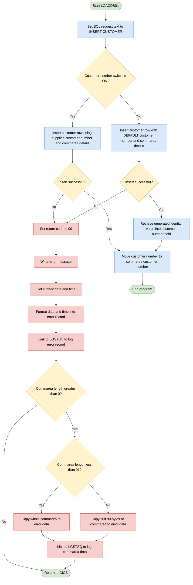
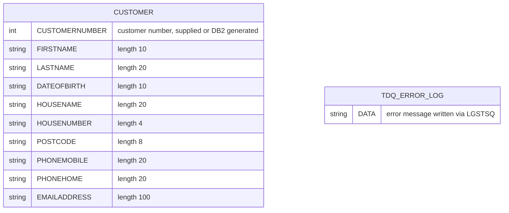

## Table of Contents

- [1. Purpose](#1-purpose)
- [2. Inputs](#2-inputs)
- [3. Outputs](#3-outputs)
  - [3.1 Database Outputs](#31-database-outputs)
  - [3.2 Communication Area (COMMAREA) Outputs](#32-communication-area-commarea-outputs)
  - [3.3 Transient Data Queue Logging / External Subprogram Outputs](#33-transient-data-queue-logging--external-subprogram-outputs)
- [4. Processing Logic](#4-processing-logic)
  - [4.1 Mermaid Flow Diagram](#41-mermaid-flow-diagram)
  - [4.2 Processing Logic Description](#42-processing-logic-description)
  - [4.3 Database Tables](#43-database-tables)
- [5. Paragraphs](#5-paragraphs)
- [6. Dependencies](#6-dependencies)
- [7. Constraints](#7-constraints)
  - [7.1 Input Data and Format Constraints](#71-input-data-and-format-constraints)
  - [7.2 Data Structure and Memory Constraints](#72-data-structure-and-memory-constraints)
  - [7.3 Control Flow and Conditional Processing Constraints](#73-control-flow-and-conditional-processing-constraints)
  - [7.4 Database and Error Handling Constraints](#74-database-and-error-handling-constraints)
  - [7.5 Operational and Environmental Constraints](#75-operational-and-environmental-constraints)
- [8. Error Handling](#8-error-handling)
  - [8.1 SQL error detection](#81-sql-error-detection)
  - [8.2 Failure signalling and termination](#82-failure-signalling-and-termination)
  - [8.3 Error logging and notification](#83-error-logging-and-notification)
  - [8.4 Defensive and boundary handling](#84-defensive-and-boundary-handling)
  - [8.5 Mechanisms not present](#85-mechanisms-not-present)
- [9. Examples](#9-examples)
  - [9.1 Example 1: Explicit customer number (LGAC-NCS = 'ON', successful insert)](#91-example-1-explicit-customer-number-lgac-ncs--on-successful-insert)
  - [9.2 Example 2: Database-assigned customer number (LGAC-NCS not 'ON')](#92-example-2-database-assigned-customer-number-lgac-ncs-not-on)
  - [9.3 Example 3: Insert failure (duplicate key)](#93-example-3-insert-failure-duplicate-key)

## 1. Purpose

LGACDB01 is a CICS subprogram with embedded DB2 SQL. It adds a new customer record to the CUSTOMER table in an insurance customer and policy application. It takes the customer's personal details from the communication area. These are first and last name, date of birth, house name and number, postcode, mobile and home phone numbers, and email address. A switch decides how the customer number is set. If the switch is on, the program inserts the number it was given. Otherwise it lets DB2 assign the number by default and then retrieves the generated identity value. In both cases the resulting customer number goes back to the caller in the communication area. If the insert fails, the program sets a return code of '90'. It also records the failure and returns control to CICS. The failure record has the date and time, the SQL operation, the SQLCODE, and up to 90 bytes of the communication area. The program writes this record by linking to the logging program LGSTSQ.

## 2. Inputs

- **Customer data passed in the communication area (DFHCOMMAREA-1, populated by the calling program)**
  - Customer identity
    - `CA-FIRST-NAME`: Customer's given name. It is inserted into the FIRSTNAME column.
    - `CA-LAST-NAME`: Customer's family name. It is inserted into the LASTNAME column.
    - `CA-DOB`: Date of birth as a 10-character string. It is inserted into the DATEOFBIRTH column.
  - Customer address
    - `CA-HOUSE-NAME`: Name of the residence. It is inserted into the HOUSENAME column.
    - `CA-HOUSE-NUM`: Street number. It is inserted into the HOUSENUMBER column.
    - `CA-POSTCODE`: Postal code. It is inserted into the POSTCODE column.
  - Contact details
    - `CA-PHONE-MOBILE`: Mobile telephone number. It is inserted into the PHONEMOBILE column.
    - `CA-PHONE-HOME`: Home telephone number. It is inserted into the PHONEHOME column.
    - `CA-EMAIL-ADDRESS`: Email address. It is inserted into the EMAILADDRESS column.
  - Customer number
    - `CA-CUSTOMER-NUM`: 10-digit customer number field in the communication area. The program overwrites it with the inserted or generated customer number so it can be returned to the caller.
    - `DB2-CUSTOMERNUM-INT`: Binary integer host variable that supplies the customer number to the insert when `LGAC-NCS` is 'ON'. The program never assigns it in the code shown, so its value must come from outside. When `LGAC-NCS` is not 'ON', it receives the database-generated identity value (`IDENTITY_VAL_LOCAL()`).

- **Processing control switch**
  - `LGAC-NCS`: Two-character working-storage switch with a default of 'ON'. When it is 'ON', the insert uses the supplied customer number (`DB2-CUSTOMERNUM-INT`). Otherwise the insert uses DEFAULT and the generated identity value is retrieved afterwards. The program has no code to change it, so it acts as a configuration setting.

- **CICS runtime context**
  - `EIBCALEN`: Length of the communication area passed by the caller. When an insert fails, it decides how many bytes of the communication area (up to 90) are written to the error queue.
  - `DFHCOMMAREA-1`: Raw communication area content. On failure, up to its first 90 bytes are copied into the error log record.
  - System date and time: Current time obtained through the CICS ASKTIME and FORMATTIME services. They populate `EM-DATE` and `EM-TIME` in the error message.

- **External data sources**
  - Db2 `CUSTOMER` table: Target of the INSERT. Its response is an input to the error-handling logic.
    - `SQLCODE`: Return code from each SQL statement. A non-zero value triggers return code '90' and error logging.
  - Db2 identity function `IDENTITY_VAL_LOCAL()`: Supplies the generated customer number when the database assigns it.

- **Error message descriptors**
  - `EM-SQLREQ`: Set internally to ' INSERT CUSTOMER'. It labels the failed SQL request in the log entry.
  - `EM-DATE` and `EM-TIME`: Set from the CICS-formatted system date and time. They timestamp the log entry.

- **Function and method parameters**
  - The program has no explicit parameters. The LINKAGE SECTION is empty and the PROCEDURE DIVISION has no USING clause. Input arrives through the CICS communication area (`DFHCOMMAREA-1`) and the CICS environment.

- **User inputs and messaging**
  - There is no console or UI input, no file input and no environment variable input. The program has no IBM MQ operations.

## 3. Outputs

### 3.1 Database Outputs
- Database 2 `CUSTOMER` Table (`INSERT` Operation)
  - `CUSTOMERNUMBER`: Populated either explicitly using `DB2-CUSTOMERNUM-INT` (when `LGAC-NCS` is `'ON'`) or generated automatically by Db2 using identity default assignment.
  - `FIRSTNAME`: Populated from `CA-FIRST-NAME` to store the customer's given name.
  - `LASTNAME`: Populated from `CA-LAST-NAME` to store the customer's family name.
  - `DATEOFBIRTH`: Populated from `CA-DOB` to record the customer's date of birth.
  - `HOUSENAME`: Populated from `CA-HOUSE-NAME` to store the residence name.
  - `HOUSENUMBER`: Populated from `CA-HOUSE-NUM` to record the street number.
  - `POSTCODE`: Populated from `CA-POSTCODE` to record the postal code.
  - `PHONEMOBILE`: Populated from `CA-PHONE-MOBILE` to record the mobile contact telephone number.
  - `PHONEHOME`: Populated from `CA-PHONE-HOME` to record the home contact telephone number.
  - `EMAILADDRESS`: Populated from `CA-EMAIL-ADDRESS` to record the electronic mail address.

### 3.2 Communication Area (COMMAREA) Outputs
- `CA-CUSTOMER-NUM`: Updated with the assigned customer number (`DB2-CUSTOMERNUM-INT`), either from the explicit input value or retrieved via Db2 `IDENTITY_VAL_LOCAL()`, and returned to the calling program.
- `CA-RETURN-CODE`: Set to `'90'` to signal a database failure to the caller if an SQL error occurs during the customer insert operation.

### 3.3 Transient Data Queue Logging / External Subprogram Outputs
- `ERROR-MSG` (Passed via `EXEC CICS LINK` to `LGSTSQ`):
  - `EM-DATE`: Formatted current date (`MMDDYYYY`) captured at error time.
  - `EM-TIME`: Formatted current time captured at error time.
  - `EM-SQLREQ`: Descriptive SQL request identifier (`' INSERT CUSTOMER'`) denoting the failed operation.
  - `EM-SQLRC`: The numeric SQL status code (`SQLCODE`) resulting from the failed Db2 operation.
- `CA-ERROR-MSG` (Passed via `EXEC CICS LINK` to `LGSTSQ`):
  - `CA-DATA`: A snapshot of the incoming COMMAREA payload (up to 90 bytes) for diagnostic and error tracing purposes.

## 4. Processing Logic

### 4.1 Mermaid Flow Diagram

### 4.2 Processing Logic Description

**High-level Summary**

LGACDB01 is a CICS COBOL program with embedded DB2 SQL. It inserts one new row into the `CUSTOMER` table. It uses the customer details passed in the communication area (commarea). The customer number is either supplied by the caller or generated by DB2. If the insert fails, the program sets return code `90`, logs the error through the `LGSTSQ` program, and returns to CICS. If the insert succeeds, it puts the customer number in the commarea's `CA-CUSTOMER-NUM` field.

**Execution Flow**

1. **Initialize the request text.** The program moves `' INSERT CUSTOMER'` to `EM-SQLREQ`. If an error occurs, the log entry then shows which SQL request failed.
2. **Choose how the customer number is obtained.** The program checks the switch `LGAC-NCS`. Its initial value is `'ON'`, and nothing in the program changes it.
   - **Switch is `ON`:** The program inserts a row into `CUSTOMER`. It takes the customer number from `DB2-CUSTOMERNUM-INT` and fills these columns from the commarea:
     - `FIRSTNAME`
     - `LASTNAME`
     - `DATEOFBIRTH`
     - `HOUSENAME`
     - `HOUSENUMBER`
     - `POSTCODE`
     - `PHONEMOBILE`
     - `PHONEHOME`
     - `EMAILADDRESS`

     The program never moves a value into `DB2-CUSTOMERNUM-INT` before this insert. The field is a binary integer with no initial value, so the number supplied to the insert is whatever the field holds at that point.
   - **Switch is not `ON`:** The program inserts the same data with the customer number set to `DEFAULT`, so DB2 generates it. After a successful insert, it runs `SET :DB2-CUSTOMERNUM-INT = IDENTITY_VAL_LOCAL()` to read back the generated number.
3. **Check the insert result.** After each insert, the program tests `SQLCODE`.
   - **`SQLCODE` is not 0:** The program moves `'90'` to `CA-RETURN-CODE` and performs `WRITE-ERROR-MESSAGE`. It then issues `EXEC CICS RETURN`, which ends processing at once.
   - **`SQLCODE` is 0:** Processing continues.
4. **Return the customer number.** The program moves `DB2-CUSTOMERNUM-INT` to `CA-CUSTOMER-NUM` so the caller can read it. It then reaches `EXIT`.
5. **Error logging (`WRITE-ERROR-MESSAGE`).**
   - The program moves `SQLCODE` to `EM-SQLRC`.
   - It gets the current time with `EXEC CICS ASKTIME`. It then uses `FORMATTIME` to produce an `MMDDYYYY` date and a time value, and moves them to `EM-DATE` and `EM-TIME`.
   - It links to program `LGSTSQ` with `ERROR-MSG` as the commarea, which writes the formatted error record.
   - If the commarea length (`EIBCALEN`) is greater than 0, it also logs the commarea contents:
     - If `EIBCALEN` is less than 91, the whole commarea goes into `CA-DATA`.
     - Otherwise only the first 90 bytes go into `CA-DATA`.
     - A second `LINK` to `LGSTSQ` with `CA-ERROR-MSG` then writes that data.
   - If `EIBCALEN` is 0, no commarea data is logged.

**External Interactions**

- **DB2 `CUSTOMER` table:** The program inserts one row and reads `IDENTITY_VAL_LOCAL()` when DB2 generates the number.
- **CICS services:**
  - `ASKTIME` and `FORMATTIME` supply the timestamp for error messages.
  - `LINK PROGRAM('LGSTSQ')` sends error records out for logging. Per the program's own comment, `LGSTSQ` writes them to a transient data queue (TDQ).
  - `RETURN` ends the transaction path when an error occurs.
- **MQ:** No IBM MQ operations are present, so no MQ documentation applies.

**Plain Language Summary**

The program adds a new customer record to the customer database table. It uses the name, birth date, address, phone numbers and email that the calling program provided. Depending on a setting, it either uses a customer number it already has or lets the database assign one. If the save fails, the program sets error code 90 and records what went wrong, with the time, date and some of the request data, in a log by calling a helper program. It then stops. If the save works, it hands the customer number back to the caller.

### 4.3 Database Tables

## 5. Paragraphs

**INSERT-CUSTOMER**
- Purpose: This is the main paragraph. It inserts a new row into the DB2 CUSTOMER table and returns the resulting customer number to the caller in the communication area.
- Operations:
  - It moves ' INSERT CUSTOMER' to EM-SQLREQ. If a later error is logged, this value shows which SQL request failed.
  - It tests the switch LGAC-NCS, which starts as 'ON'. The test selects one of two insert strategies.
- Control flow, when LGAC-NCS = 'ON':
  - It runs an `INSERT INTO CUSTOMER` that supplies the customer number explicitly from DB2-CUSTOMERNUM-INT.
  - The other columns come from CA-FIRST-NAME, CA-LAST-NAME, CA-DOB, CA-HOUSE-NAME, CA-HOUSE-NUM, CA-POSTCODE, CA-PHONE-MOBILE, CA-PHONE-HOME and CA-EMAIL-ADDRESS.
  - If SQLCODE is not 0, it moves '90' to CA-RETURN-CODE and performs **WRITE-ERROR-MESSAGE**. It then issues `EXEC CICS RETURN`, which ends the transaction immediately.
- Control flow, otherwise:
  - It runs the same insert, but CUSTOMERNUMBER is set to `DEFAULT`. The database generates the number.
  - If SQLCODE is not 0, it takes the same error path: '90' to CA-RETURN-CODE, perform **WRITE-ERROR-MESSAGE**, then `EXEC CICS RETURN`.
  - If the insert succeeds, it runs `SET :DB2-CUSTOMERNUM-INT = IDENTITY_VAL_LOCAL()`. This retrieves the identity value that was just assigned.
- After the IF block, it moves DB2-CUSTOMERNUM-INT to CA-CUSTOMER-NUM, so the caller receives the inserted or assigned customer number. It then ends with `EXIT`.
- External interactions:
  - DB2: the insert into the CUSTOMER table and the `IDENTITY_VAL_LOCAL()` call.
  - CICS: `RETURN` on error.

**WRITE-ERROR-MESSAGE**
- Purpose: This paragraph builds an error log entry and writes it to the CICS error queue through the LGSTSQ program. **INSERT-CUSTOMER** performs it after a failed SQL insert.
- Operations:
  - It moves SQLCODE to EM-SQLRC, the formatted SQL return code field in the error record.
  - It issues `EXEC CICS ASKTIME ABSTIME(WS-ABSTIME)` to get the current system time.
  - It issues `EXEC CICS FORMATTIME`, which converts that value to an MMDDYYYY date in WS-DATE and a time in WS-TIME.
  - It moves WS-DATE to EM-DATE and WS-TIME to EM-TIME.
  - It issues `EXEC CICS LINK PROGRAM('LGSTSQ')` with ERROR-MSG as the COMMAREA. This writes the main error record, which holds the date, time, program name, customer and policy number fields, the SQL request text and the SQLCODE.
- Control flow:
  - If EIBCALEN > 0, the incoming COMMAREA is also logged.
  - If EIBCALEN < 91, it moves the first EIBCALEN bytes of DFHCOMMAREA-1 to CA-DATA. Otherwise it moves the first 90 bytes.
  - In both cases it then links to LGSTSQ with CA-ERROR-MSG as the COMMAREA.
  - If EIBCALEN is 0, no COMMAREA is logged.
- External interactions:
  - CICS: ASKTIME, FORMATTIME and up to two LINKs to LGSTSQ. LGSTSQ writes the entries to the error queue.
- The paragraph ends with `EXIT`. A trailing `EXIT PROGRAM` follows it and is not reached in normal flow.

## 6. Dependencies

- **Database dependencies (DB2)**
  - CUSTOMER table
    - The program inserts one new customer row into it.
    - The columns written are CUSTOMERNUMBER, FIRSTNAME, LASTNAME, DATEOFBIRTH, HOUSENAME, HOUSENUMBER, POSTCODE, PHONEMOBILE, PHONEHOME and EMAILADDRESS.
    - The table must exist, and its CUSTOMERNUMBER column must be able to take a supplied value or a DEFAULT value. The default is presumably an identity column.
  - DB2 identity function IDENTITY_VAL_LOCAL()
    - When the database assigns the customer number, the program calls this function.
    - It returns the assigned number, which the program stores in DB2-CUSTOMERNUM-INT.
  - SQL communication area (SQLCA)
    - It is declared in the program as an expansion of the EXEC SQL INCLUDE SQLCA statement.
    - The program tests SQLCODE after each INSERT. A non-zero SQLCODE sets the return code to '90' and triggers error logging.
    - SQLCODE is also copied into EM-SQLRC for the error message.
  - DB2 host variables
    - DB2-CUSTOMERNUM-INT is the customer number, either supplied to the insert or returned from the identity value.
    - The remaining host variables are the CA-* customer fields passed in the communication area.

- **Called programs and subroutines**
  - LGSTSQ, called through EXEC CICS LINK
    - It is a logging program that writes error messages to a transient data queue.
    - The program links to it with ERROR-MSG, which holds the date, time, customer number, policy number, SQL request and SQLCODE.
    - It links to it again with CA-ERROR-MSG, which holds up to the first 90 bytes of the incoming communication area.
    - If EIBCALEN is 90 or less, only the bytes actually passed are included. If EIBCALEN is 91 or more, the first 90 bytes are used.

- **CICS runtime services**
  - EXEC CICS RETURN
    - It ends the transaction when an SQL insert fails.
  - EXEC CICS ASKTIME and EXEC CICS FORMATTIME
    - They get the current system time and format it into WS-DATE (MMDDYYYY) and WS-TIME.
    - The results fill EM-DATE and EM-TIME in the error log entry.
  - EXEC CICS LINK
    - It is the mechanism used to call LGSTSQ.
  - CICS Execute Interface Block (EIB) field EIBCALEN
    - It gives the length of the communication area passed in.
    - The program uses it to decide how much of the communication area to log.
  - Transient data queue
    - It is written indirectly by LGSTSQ. This program does not name the queue.

- **Input parameters and data sources**
  - Communication area from the calling program
    - It uses the layout of the LGCMAREA copybook, which is expanded inline in the source. It is not referenced through the LINKAGE SECTION in this source.
    - Inputs read from it:
      - CA-FIRST-NAME
      - CA-LAST-NAME
      - CA-DOB
      - CA-HOUSE-NAME
      - CA-HOUSE-NUM
      - CA-POSTCODE
      - CA-PHONE-MOBILE
      - CA-PHONE-HOME
      - CA-EMAIL-ADDRESS
    - Outputs written to it:
      - CA-CUSTOMER-NUM is set to the inserted or assigned customer number.
      - CA-RETURN-CODE is set to '90' on a database error.
    - The other policy-related layouts in the communication area (policy, endowment, house, motor, commercial and claim) are defined but not used by this program.
  - Copybook LGCMAREA
    - It defines the shared communication area structure. It is included as expanded inline source.

- **Configuration and control values**
  - LGAC-NCS switch
    - It is a working-storage item with the value 'ON'. It is not read from an external source.
    - When it is 'ON', the insert supplies the customer number from DB2-CUSTOMERNUM-INT.
    - Otherwise the insert uses DEFAULT, and the generated identity value is retrieved with IDENTITY_VAL_LOCAL().
  - Customer number supplied to the insert
    - The program never sets DB2-CUSTOMERNUM-INT before the insert when LGAC-NCS is 'ON'. The value must therefore be provided by the surrounding environment, or it is zero or uninitialized.

- **Runtime environment**
  - A CICS transaction environment with a DB2 connection (CICS-DB2 attachment) is required for the EXEC CICS and EXEC SQL statements to work.
  - The program has no file I/O and no IBM MQ operations.

## 7. Constraints

### 7.1 Input Data and Format Constraints

- Input Field Structures and Length Limits
  - `CA-REQUEST-ID`: Must conform to a 6-character alphanumeric format (`PIC X(6)`).
  - `CA-RETURN-CODE`: Must conform to a 2-digit numeric format (`PIC 9(2)`).
  - `CA-CUSTOMER-NUM`: Must conform to a 10-digit numeric format (`PIC 9(10)`).
  - `CA-FIRST-NAME`: Constrained to a maximum length of 10 alphanumeric characters (`PIC X(10)`).
  - `CA-LAST-NAME`: Constrained to a maximum length of 20 alphanumeric characters (`PIC X(20)`).
  - `CA-DOB`: Constrained to a 10-character alphanumeric string representation of date of birth (`PIC X(10)`), typically formatted as `YYYY-MM-DD`.
  - `CA-HOUSE-NAME`: Constrained to a maximum length of 20 alphanumeric characters (`PIC X(20)`).
  - `CA-HOUSE-NUM`: Constrained to a maximum length of 4 alphanumeric characters (`PIC X(4)`).
  - `CA-POSTCODE`: Constrained to a maximum length of 8 alphanumeric characters (`PIC X(8)`).
  - `CA-PHONE-MOBILE`: Constrained to a maximum length of 20 alphanumeric characters (`PIC X(20)`).
  - `CA-PHONE-HOME`: Constrained to a maximum length of 20 alphanumeric characters (`PIC X(20)`).
  - `CA-EMAIL-ADDRESS`: Constrained to a maximum length of 100 alphanumeric characters (`PIC X(100)`).
  - `DB2-CUSTOMERNUM-INT`: Constrained to a signed 4-byte binary integer (`PIC S9(9) COMP`).

### 7.2 Data Structure and Memory Constraints

- Communication Area Overlay Structure
  - `DFHCOMMAREA-1`: Defined with a fixed total length where `CA-REQUEST-SPECIFIC` (`PIC X(32482)`) is shared across multiple request layouts using COBOL `REDEFINES`.
  - `CA-CUSTOMER-REQUEST`: Overlays the first 32,482 bytes of `CA-REQUEST-SPECIFIC` and includes `CA-POLICY-DATA` (`PIC X(32267)`).
  - The program assumes the communication area layout conforms strictly to the `DFHCOMMAREA-1` structure.

### 7.3 Control Flow and Conditional Processing Constraints

- Customer Number Assignment Mode Switching (`LGAC-NCS`)
  - Evaluated via `IF LGAC-NCS = 'ON'` to determine customer insertion mode:
    - When `LGAC-NCS = 'ON'`: The customer record is inserted using an explicit customer number passed via host variable `:DB2-CUSTOMERNUM-INT`.
    - When `LGAC-NCS NOT = 'ON'`: The customer record is inserted using the DB2 `DEFAULT` identity specification (`CUSTOMERNUMBER = DEFAULT`). Immediately following successful insertion, DB2's `IDENTITY_VAL_LOCAL()` function is invoked to assign the generated identity value to `:DB2-CUSTOMERNUM-INT`.

### 7.4 Database and Error Handling Constraints

- SQL Execution and Return Code Validation
  - `SQLCODE` is evaluated immediately following each `EXEC SQL INSERT` statement.
  - If `SQLCODE NOT EQUAL 0`:
    - `CA-RETURN-CODE` is set to `'90'` to indicate a database failure.
    - Error reporting routine `WRITE-ERROR-MESSAGE` is performed.
    - Program execution terminates immediately via `EXEC CICS RETURN`, preventing the return of customer number data.
  - If `SQLCODE EQUAL 0`:
    - The value of `DB2-CUSTOMERNUM-INT` is transferred to `CA-CUSTOMER-NUM` for return to the caller.

### 7.5 Operational and Environmental Constraints

- Error Logging and Tracing Constraints
  - System timestamp retrieval: The error logger relies on CICS built-in functions `EXEC CICS ASKTIME` and `EXEC CICS FORMATTIME` with `MMDDYYYY` and `TIME` formats.
  - External logging dependency: Error logging requires the availability of the `LGSTSQ` subprogram via `EXEC CICS LINK PROGRAM('LGSTSQ')`.
  - Commarea dump truncation: Error logging inspects `EIBCALEN` to safely handle variable-sized or missing COMMAREA payloads:
    - If `EIBCALEN <= 0`: No COMMAREA content is logged.
    - If `0 < EIBCALEN < 91`: Only the exact number of bytes indicated by `EIBCALEN` (`DFHCOMMAREA-1(1:EIBCALEN)`) are copied to `CA-DATA` and logged.
    - If `EIBCALEN >= 91`: The commarea data is truncated to a maximum limit of 90 bytes (`DFHCOMMAREA-1(1:90)`).

## 8. Error Handling

### 8.1 SQL error detection

- **Check after the customer insert with an explicit customer number**
  - The check runs when the customer-number switch (LGAC-NCS) is 'ON'. In that case the insert supplies the customer number from the DB2 host variable (DB2-CUSTOMERNUM-INT).
  - After the insert, the program tests whether SQLCODE is anything other than zero. Any non-zero value counts as a failure. This covers duplicate keys, constraint violations, resource problems and similar errors.
  - The program does not distinguish between specific SQLCODE values. Every failure takes the same path.
- **Check after the customer insert with a database-generated number**
  - The same non-zero SQLCODE test follows the insert that uses the DEFAULT customer number.
  - A failure takes the same handling path as in the explicit-number case.
- **Unchecked identity retrieval**
  - After a successful default-number insert, the program reads the generated number with IDENTITY_VAL_LOCAL.
  - SQLCODE is not checked after that statement. A failure there would go undetected. The program would then copy whatever is in the DB2 host variable (DB2-CUSTOMERNUM-INT) into the communication area customer number (CA-CUSTOMER-NUM).

### 8.2 Failure signalling and termination

- **Return code to the caller**
  - On any insert failure, the program sets the communication area return code (CA-RETURN-CODE) to '90'. This value tells the calling program that the customer insert failed.
  - No other return codes are set. Success is not signalled explicitly. The return code keeps its incoming value, and the customer number is set only on the success path.
- **Immediate exit on failure**
  - After logging the error, the program issues a CICS RETURN. This ends the transaction at once and hands control back to the caller.
  - The program does not carry on to the customer-number assignment. The communication area therefore never receives a customer number after a failed insert.
  - No rollback or syncpoint backout is issued explicitly. Any recovery is left to CICS and DB2 when the task ends.

### 8.3 Error logging and notification

- **Central error-logging routine (WRITE-ERROR-MESSAGE)**
  - Both insert failure paths run this routine, so the logging is consistent.
  - **Error message contents**
    - The routine copies SQLCODE into the formatted error message field (EM-SQLRC), which shows its sign.
    - The message identifies the failed operation through the SQL request field (EM-SQLREQ), which is set to ' INSERT CUSTOMER' at the start of the program.
    - The message also carries the program name, and customer-number and policy-number placeholders. These two fields are never filled by this program, so they stay as spaces.
  - **Timestamping**
    - The routine gets the current system time with CICS ASKTIME.
    - It formats the date (MMDDYYYY) and time with CICS FORMATTIME.
    - It moves the results to the error message date (EM-DATE) and time (EM-TIME) fields. This lets log entries be correlated by when they happened.
  - **Logging through a called program**
    - The formatted error message is sent by a CICS LINK to the logging program LGSTSQ, which writes it to a queue. The queue is described in the source as a transient data queue.
    - The CICS LINK calls have no RESP or RESP2 options and no HANDLE CONDITION. A failure of the logging call itself is not detected or handled.
- **Communication area snapshot for diagnosis**
  - After the main error message, the routine also logs the content of the incoming communication area.
  - It does this only when the communication area length (EIBCALEN) is greater than zero. This avoids referencing a missing communication area.
  - **Short communication area**
    - If the length is under 91 bytes, only the bytes actually supplied (EIBCALEN of them) are copied into the 90-byte data field (CA-DATA). The shorter content is not padded or overrun.
    - A second CICS LINK to LGSTSQ then logs it.
  - **Longer communication area**
    - If the length is 91 bytes or more, the first 90 bytes are copied and logged through a further LINK to LGSTSQ.
    - The rest of the data is truncated.

### 8.4 Defensive and boundary handling

- **Guard against a missing communication area**
  - The EIBCALEN test described above protects the reference-modified moves from invalid lengths.
- **Length-bounded data capture**
  - The 90-byte limit on the logged communication area data stops the log entry from overflowing its buffer.

### 8.5 Mechanisms not present

- The program has no retry logic, no fallback to default values on SQL failure, and no CICS condition handling (HANDLE CONDITION, HANDLE ABEND, RESP checks). It has no input validation of the communication area fields before the insert. It has no file status handling, because it uses no files. It has no MQ operations.

## 9. Examples

### 9.1 Example 1: Explicit customer number (LGAC-NCS = 'ON', successful insert)

**Input**

| Field | Value |
|---|---|
| LGAC-NCS | `ON` (the default) |
| DB2-CUSTOMERNUM-INT | `1000042` |
| CA-FIRST-NAME | `JOHN` |
| CA-LAST-NAME | `SMITH` |
| CA-DOB | `1980-05-21` |
| CA-HOUSE-NAME | `ROSE COTTAGE` |
| CA-HOUSE-NUM | `12` |
| CA-POSTCODE | `AB1 2CD` |
| CA-PHONE-MOBILE | `07700900123` |
| CA-PHONE-HOME | `01632960001` |
| CA-EMAIL-ADDRESS | `john.smith@example.com` |
| SQLCODE (DB2 result) | `0` |

**Expected output**

- A row is inserted into `CUSTOMER` with `CUSTOMERNUMBER = 1000042` and the supplied name, date of birth, address and contact details.
- `CA-CUSTOMER-NUM` = `0001000042`.
- `CA-RETURN-CODE` is not changed. No error message is written.

**Explanation**

`EM-SQLREQ` is set to `' INSERT CUSTOMER'`. `LGAC-NCS = 'ON'`, so the first `INSERT` runs and uses `DB2-CUSTOMERNUM-INT` as the customer number. `SQLCODE` is 0, so the error branch is skipped. The program then runs `MOVE DB2-CUSTOMERNUM-INT TO CA-CUSTOMER-NUM`, which returns the number to the caller.

### 9.2 Example 2: Database-assigned customer number (LGAC-NCS not 'ON')

**Input**

| Field | Value |
|---|---|
| LGAC-NCS | `OFF` |
| CA-FIRST-NAME | `MARY` |
| CA-LAST-NAME | `JONES` |
| CA-DOB | `1975-11-02` |
| CA-HOUSE-NAME | `THE OAKS` |
| CA-HOUSE-NUM | `7` |
| CA-POSTCODE | `XY9 8ZZ` |
| CA-PHONE-MOBILE | `07700900456` |
| CA-PHONE-HOME | `01632960002` |
| CA-EMAIL-ADDRESS | `mary.jones@example.com` |
| SQLCODE (INSERT) | `0` |
| IDENTITY_VAL_LOCAL() | `1000043` |

**Expected output**

- A row is inserted with `CUSTOMERNUMBER` set by `DEFAULT`, which gives `1000043`.
- `DB2-CUSTOMERNUM-INT` = `1000043`.
- `CA-CUSTOMER-NUM` = `0001000043`.
- `CA-RETURN-CODE` is not changed.

**Explanation**

`LGAC-NCS` is not `'ON'`, so the `ELSE` branch runs. It inserts the row with `DEFAULT` for `CUSTOMERNUMBER`, so DB2 generates the number. The program then runs `SET :DB2-CUSTOMERNUM-INT = IDENTITY_VAL_LOCAL()` to read the generated value. It copies that value to `CA-CUSTOMER-NUM`.

### 9.3 Example 3: Insert failure (duplicate key)

**Input**

| Field | Value |
|---|---|
| LGAC-NCS | `ON` |
| DB2-CUSTOMERNUM-INT | `1000042` (already exists) |
| EIBCALEN | `200` |
| SQLCODE (INSERT) | `-803` |
| Current date and time (CICS FORMATTIME) | `05022024` / `153045` |

**Expected output**

- `CA-RETURN-CODE` = `90`.
- The program links to `LGSTSQ` twice to write to the error queue:
  - The first message is the `ERROR-MSG` record: `05022024 153045 LGACDB01 CNUM=          PNUM=           INSERT CUSTOMER SQLCODE=-00803`.
  - The second message is `COMMAREA=` followed by the first 90 bytes of the commarea. It is 90 bytes because `EIBCALEN` is 91 or more.
- The program ends with `EXEC CICS RETURN`. `CA-CUSTOMER-NUM` is not updated.

**Explanation**

`SQLCODE` is not 0, so the program moves `'90'` to `CA-RETURN-CODE` and performs `WRITE-ERROR-MESSAGE`. That paragraph moves `SQLCODE` to `EM-SQLRC`. It gets the current time and date with `ASKTIME` and `FORMATTIME`, and stores them in `EM-DATE` and `EM-TIME`. Then it links to `LGSTSQ` to log the error. If `EIBCALEN` were 1 to 90, only that many bytes of the commarea would be logged. The same failure handling applies to the `DEFAULT` insert when `LGAC-NCS` is not `'ON'`.

---

Generated by IBM Bob Premium Package for Z
